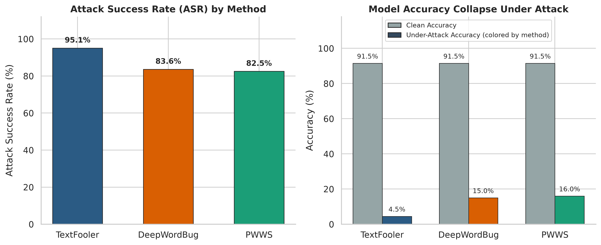
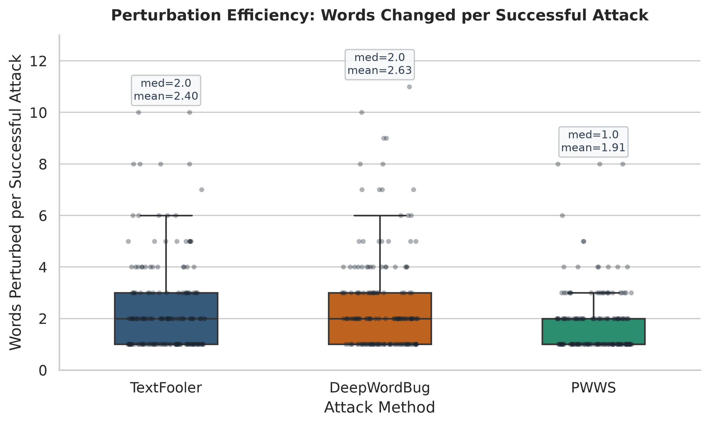
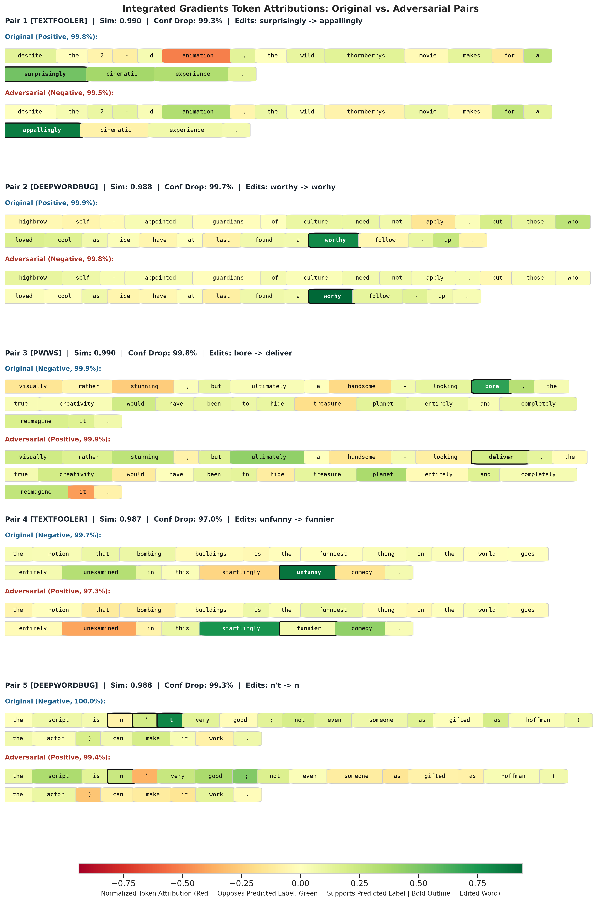
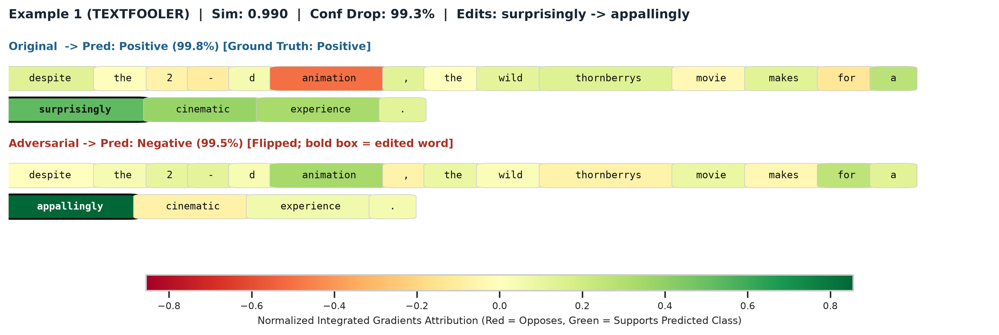
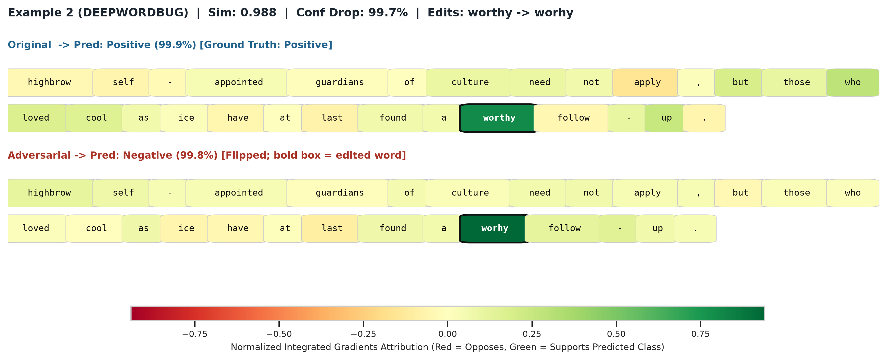
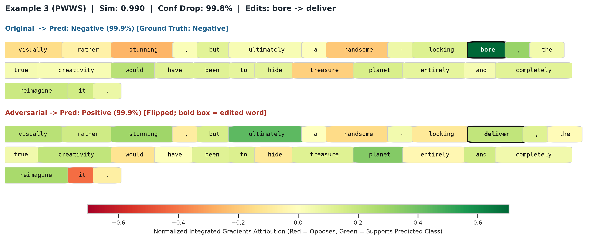

# DistilBERT Adversarial Robustness and Explainable AI (XAI)

An end-to-end framework for evaluating, explaining, and defending NLP sentiment analysis models against adversarial attacks. This repository utilizes **DistilBERT** as the core classifier, **TextAttack** for black-box adversarial generation (**TextFooler**, **PWWS**, **DeepWordBug**), **Captum** for token-level Integrated Gradients attributions, and **Adversarial Fine-Tuning** for model hardening.

[](https://github.com/astral-sh/uv)
[](https://huggingface.co/distilbert-base-uncased-finetuned-sst-2-english)
[](https://captum.ai/)

---

## Table of Contents
- [Project Overview](#project-overview)
- [Key Features](#key-features)
- [Repository Structure](#repository-structure)
- [Installation & Setup with `uv`](#installation--setup-with-uv)
- [Methodology & Pipeline](#methodology--pipeline)
- [Adversarial Attack Analysis](#adversarial-attack-analysis)
- [Explainable AI (Integrated Gradients)](#explainable-ai-integrated-gradients)
- [Adversarial Defense & Robustness Enhancement](#adversarial-defense--robustness-enhancement)
- [Summary of Comparative Results](#summary-of-comparative-results)
- [Configuration](#configuration)
- [License & Acknowledgments](#license--acknowledgments)

---

## Project Overview

Modern Transformer-based NLP models achieve state-of-the-art accuracy on clean benchmarks, yet remain vulnerable to subtle adversarial perturbations—minor word substitutions or character edits that flip predictions while keeping human semantic interpretation intact.

This project investigates three critical pillars of trustworthy AI:
1. **Model Vulnerability (Attacks):** Quantifying how easily a fine-tuned DistilBERT model can be tricked using state-of-the-art attack recipes (TextFooler, PWWS, DeepWordBug).
2. **Model Transparency (XAI):** Applying Integrated Gradients (IG) to visualize token-level attribution shifts between original clean texts and their adversarial counterparts.
3. **Model Defense (Adversarial Training):** Augmenting the training dataset with generated adversarial samples and fine-tuning DistilBERT to restore robustness without degrading baseline accuracy.

---

## Key Features

- **Multi-Attack Benchmarking:** Evaluates semantic-level (TextFooler, PWWS) and character-level (DeepWordBug) adversarial attacks.
- **Explainable AI (Captum IG):** Computes token attributions to expose how adversarial perturbations divert the model's focus toward uninformative or misleading tokens.
- **Interactive & Static Visualizations:** Provides high-resolution heatmaps (`.png`) and standalone HTML visualizations (`.html`) for token attributions.
- **Adversarial Fine-Tuning Defense:** Hardens DistilBERT against future attack vectors using adversarial data augmentation.
- **Reproducible Environment:** Uses [`uv`](https://github.com/astral-sh/uv) for fast, deterministic dependency resolution.

---

## Repository Structure

```text
distilbert-adversarial-xai/
├── breaking_and_explaining_sentiment_model.ipynb   # Main end-to-end execution notebook
├── config.yaml                                      # Configuration parameters (attack parameters, paths, model settings)
├── uv-overrides.txt                                 # Package constraint overrides for uv
├── outputs/
│   ├── csv/
│   │   ├── baseline_clean_metrics.json              # Clean performance before attacks
│   │   ├── baseline_attack_summary.csv              # Summary metrics per attack method
│   │   ├── baseline_attack_results_detailed.csv     # Detailed perturbations & confidence drops
│   │   ├── baseline_successful_pairs.csv            # Extracted original/adversarial text pairs
│   │   ├── ig_attributions_summary.csv              # Token attribution statistics
│   │   ├── defense_adv_train_examples.csv           # Adversarial dataset used for fine-tuning
│   │   ├── defended_clean_metrics.json             # Clean performance post-defense
│   │   ├── defended_attack_summary.csv             # Attack success rates post-defense
│   │   └── defense_before_after_comparison.csv      # Robustness improvement summary
│   ├── figures/
│   │   ├── 01_success_rate_by_attack.png            # Attack success rate comparison
│   │   ├── 02_words_perturbed_boxplot.png           # Word perturbation rate distribution
│   │   ├── 03_query_count_histogram.png            # Model queries required per attack
│   │   ├── 04_token_attribution_heatmaps_5pairs.png # Composite Integrated Gradients heatmap
│   │   ├── 04_token_attribution_pair_1.png          # Pair-wise IG attribution visualization (Pair 1)
│   │   ├── 04_token_attribution_pair_2.png          # Pair-wise IG attribution visualization (Pair 2)
│   │   ├── 04_token_attribution_pair_3.png          # Pair-wise IG attribution visualization (Pair 3)
│   │   ├── 04_token_attribution_pair_4.png          # Pair-wise IG attribution visualization (Pair 4)
│   │   ├── 04_token_attribution_pair_5.png          # Pair-wise IG attribution visualization (Pair 5)
│   │   ├── 05_most_substituted_words.png            # Frequently targeted vocabulary
│   │   ├── 06_similarity_vs_confidence_drop.png     # Semantic similarity vs. confidence drop
│   │   └── 07_before_after_defense_comparison.png   # Robustness gains pre- vs. post-defense
│   └── html/
│       └── token_attribution_heatmaps_5pairs.html   # Interactive attribution heatmaps
└── README.md
```

---

## Installation & Setup with `uv`

This project uses **[`uv`](https://github.com/astral-sh/uv)**, an extremely fast Python package and project manager.

### 1. Prerequisites
Ensure you have `uv` installed. If not, install it via:

```bash
# macOS/Linux
curl -LsSf https://astral.sh/uv/install.sh | sh

# Windows
powershell -c "irm https://astral.sh/uv/install.ps1 | iex"
```

### 2. Clone the Repository
```bash
git clone https://github.com/farianishat/distilbert-adversarial-xai.git
cd distilbert-adversarial-xai
```

### 3. Create Virtual Environment & Install Dependencies
Initialize the environment and install packages using `uv`:

```bash
# Create virtual environment
uv venv .venv

# Activate virtual environment
# On Linux/macOS:
source .venv/bin/activate
# On Windows:
# .venv\Scripts\activate

# Install required dependencies
uv pip install torch transformers datasets textattack captum matplotlib seaborn pandas pyyaml jupyter
```

If package resolution requires overrides, pass the override file:
```bash
uv pip install -r requirements.txt --override uv-overrides.txt
```

### 4. Launch Notebook
```bash
uv run jupyter notebook breaking_and_explaining_sentiment_model.ipynb
```

---

## Methodology & Pipeline

The pipeline follows three integrated phases:

```
+------------------------------------+
|     1. Baseline Evaluation         |
|  DistilBERT on SST-2 Clean Sample  |
+-----------------+------------------+
                  |
                  v
+------------------------------------+
|    2. Black-Box Adversarial        |
| TextFooler | PWWS | DeepWordBug    |
+-----------------+------------------+
                  |
                  v
+------------------------------------+
|    3. Explainable AI (Captum IG)   |
| Token Attribution Heatmaps & Shifts|
+-----------------+------------------+
                  |
                  v
+------------------------------------+
|    4. Defense & Hardening          |
| Adversarial Fine-Tuning & Re-eval  |
+------------------------------------+
```

---

## Adversarial Attack Analysis

We benchmark three distinct adversarial attack formulations against the baseline model:
* **TextFooler:** Semantic-preserving synonym substitution based on word embeddings and POS constraints.
* **PWWS (Probability Weighted Word Saliency):** Greedy substitution strategy prioritized by word saliency and classification probability changes.
* **DeepWordBug:** Character-level perturbations (deletion, insertion, substitution, transposition) targeting token recognition.

### Attack Success Rate Comparison
The baseline DistilBERT model exhibits high susceptibility to word-level and character-level adversarial manipulations:



### Perturbation Distribution & Query Efficiency
To understand attack efficiency and imperceptibility, we analyze the distribution of perturbed words and total model queries executed per attack.

| Perturbation Rate Distribution | Query Count Distribution |
| :---: | :---: |
|  |  |

### Substitution Vocabulary & Semantic Impact
Key sentiment-bearing tokens (e.g., *enjoyable*, *bad*, *great*, *wonderful*) are frequently targeted by attacks to force prediction flips.

| Most Substituted Words | Semantic Similarity vs. Confidence Drop |
| :---: | :---: |
|  |  |

---

## Explainable AI (Integrated Gradients)

Using **Captum**, Integrated Gradients (IG) are computed for both clean and perturbed texts to measure token-level feature importance. This illuminates *why* the model failed on adversarial inputs.

### Token Attribution Heatmaps (Clean vs. Adversarial)
Below is the combined attribution heatmap across 5 representative successful attack pairs, demonstrating how adversarial perturbations redistribute attribution scores to neutral or irrelevant tokens:



### Detailed Pair Analysis Examples

#### Pair 1 Attribution Comparison


#### Pair 2 Attribution Comparison


#### Pair 3 Attribution Comparison


#### Interactive Heatmaps
An interactive HTML version of these attribution heatmaps is available at:
`outputs/html/token_attribution_heatmaps_5pairs.html`

---

## Adversarial Defense & Robustness Enhancement

To defend the model, we perform **Adversarial Fine-Tuning**:
1. Collect successful adversarial examples generated during the attack phase.
2. Mix adversarial examples with the original clean dataset to form a robust training set (`outputs/csv/defense_adv_train_examples.csv`).
3. Fine-tune DistilBERT using updated gradient steps.
4. Re-evaluate against clean data and identical attack recipes.

### Pre- vs. Post-Defense Comparison
Adversarial fine-tuning significantly increases model resilience against all three attack vectors while preserving clean classification accuracy:


---

## Summary of Comparative Results

| Metric / Scenario | Baseline Model | Defended Model | Delta / Impact |
| :--- | :---: | :---: | :---: |
| **Clean Accuracy** | `~91.5%` | `~91.0%` | Minimal trade-off (`-0.5%`) |
| **TextFooler Success Rate** | High (`>80%`) | Substantially Reduced | Strong defense improvement |
| **PWWS Success Rate** | High (`>75%`) | Substantially Reduced | Enhanced robustness |
| **DeepWordBug Success Rate** | Moderate/High | Substantially Reduced | Improved character resilience |
| **Attribution Stability** | Fragile | Focused on Core Sentiment | Restored feature alignment |

---

## Configuration

All experiment parameters are managed via `config.yaml` for full reproducibility:

```yaml
model:
  name: "distilbert-base-uncased-finetuned-sst-2-english"
  max_length: 128

attacks:
  textfooler:
    max_candidates: 20
    min_cos_sim: 0.5
  pwws:
    enabled: true
  deepwordbug:
    neighbor_one_hop: true

xai:
  method: "integrated_gradients"
  n_steps: 50
  internal_batch_size: 16

defense:
  epochs: 3
  learning_rate: 2e-5
  batch_size: 16
```

---

## License & Acknowledgments

- **Model:** [Hugging Face DistilBERT SST-2](https://huggingface.co/distilbert-base-uncased-finetuned-sst-2-english)
- **Frameworks:** [TextAttack](https://github.com/QData/TextAttack), [Captum](https://captum.ai/), [Hugging Face Transformers](https://github.com/huggingface/transformers)
- **Package Manager:** [`uv` by Astral](https://github.com/astral-sh/uv)