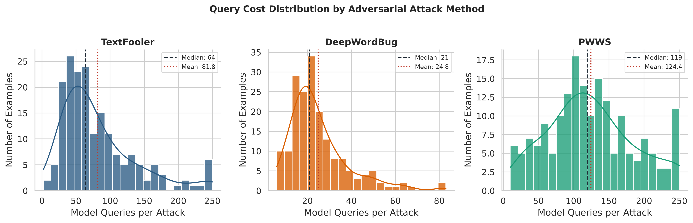
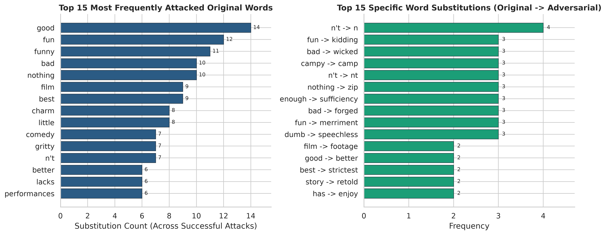
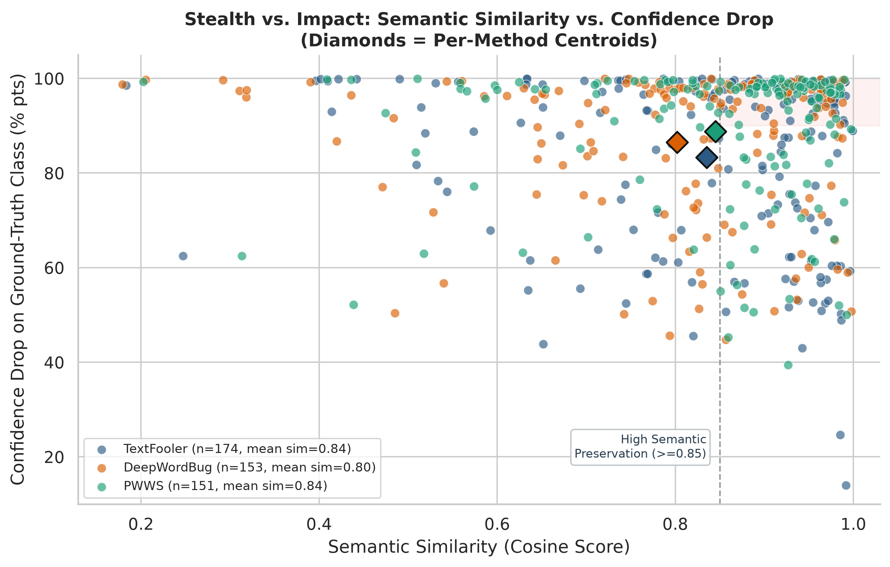
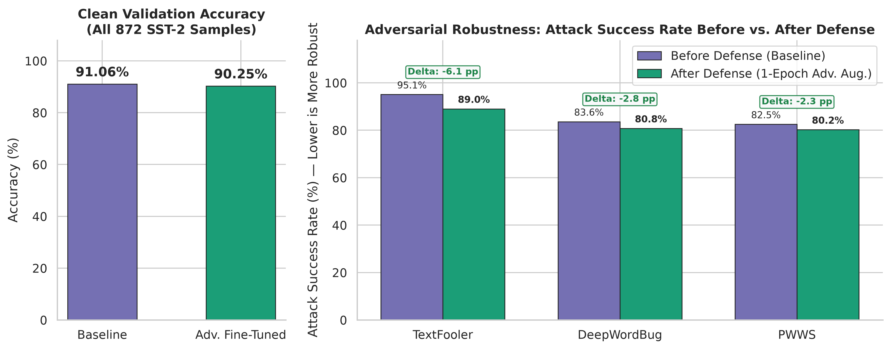

# DistilBERT Adversarial Robustness and Explainable AI (XAI)

An end-to-end framework for evaluating, explaining, and defending NLP sentiment analysis models against adversarial attacks. This repository utilizes **DistilBERT** as the core classifier, **TextAttack** for black-box adversarial generation (**TextFooler**, **PWWS**, **DeepWordBug**), **Captum** for token-level Integrated Gradients attributions, and **Adversarial Fine-Tuning** for model hardening.

[](https://github.com/astral-sh/uv)
[](https://huggingface.co/distilbert-base-uncased-finetuned-sst-2-english)
[](https://captum.ai/)

---

## Table of Contents
- [Project Overview](#project-overview)
- [Key Features](#key-features)
- [Repository Structure](#repository-structure)
- [Installation & Setup with `uv`](#installation--setup-with-uv)
- [Methodology & Pipeline](#methodology--pipeline)
- [Adversarial Attack Analysis](#adversarial-attack-analysis)
- [Explainable AI (Integrated Gradients)](#explainable-ai-integrated-gradients)
- [Adversarial Defense & Robustness Enhancement](#adversarial-defense--robustness-enhancement)
- [Summary of Comparative Results](#summary-of-comparative-results)
- [Limitations](#limitations)
- [Configuration](#configuration)
- [License & Acknowledgments](#license--acknowledgments)

---

## Project Overview

Modern Transformer-based NLP models achieve state-of-the-art accuracy on clean benchmarks, yet remain vulnerable to subtle adversarial perturbations—minor word substitutions or character edits that flip predictions while keeping human semantic interpretation intact.

This project investigates three critical pillars of trustworthy AI:
1. **Model Vulnerability (Attacks):** Quantifying how easily a fine-tuned DistilBERT model can be tricked using state-of-the-art attack recipes (TextFooler, PWWS, DeepWordBug).
2. **Model Transparency (XAI):** Applying Integrated Gradients (IG) to visualize token-level attribution shifts between original clean texts and their adversarial counterparts.
3. **Model Defense (Adversarial Training):** Augmenting the training data with generated adversarial samples, fine-tuning DistilBERT, and measuring how much robustness improves and what it costs in clean accuracy.

---

## Key Features

- **Multi-Attack Benchmarking:** Evaluates semantic-level (TextFooler, PWWS) and character-level (DeepWordBug) adversarial attacks.
- **Explainable AI (Captum IG):** Computes token attributions to expose how adversarial perturbations divert the model's focus toward uninformative or misleading tokens.
- **Interactive & Static Visualizations:** Provides high-resolution heatmaps (`.png`) and standalone HTML visualizations (`.html`) for token attributions.
- **Adversarial Fine-Tuning Defense:** Tests light adversarial data augmentation (300 adversarial + 1,200 clean training sentences, 1 epoch) and re-attacks the model.
- **Reproducible Environment:** Uses [`uv`](https://github.com/astral-sh/uv) for fast, deterministic dependency resolution.

---

## Repository Structure

```text
distilbert-adversarial-xai/
├── breaking_and_explaining_sentiment_model.ipynb   # Main end-to-end execution notebook
├── config.yaml                                      # Configuration parameters (attack parameters, paths, model settings)
├── uv-overrides.txt                                 # Package constraint overrides for uv
├── outputs/
│   ├── csv/
│   │   ├── baseline_clean_metrics.json              # Clean performance before attacks
│   │   ├── baseline_attack_summary.csv              # Summary metrics per attack method
│   │   ├── baseline_attack_results_detailed.csv     # Detailed perturbations & confidence drops
│   │   ├── baseline_successful_pairs.csv            # Extracted original/adversarial text pairs
│   │   ├── ig_attributions_summary.csv              # Token attribution statistics
│   │   ├── defense_adv_train_examples.csv           # Adversarial dataset used for fine-tuning
│   │   ├── defended_clean_metrics.json             # Clean performance post-defense
│   │   ├── defended_attack_summary.csv             # Attack success rates post-defense
│   │   └── defense_before_after_comparison.csv      # Robustness improvement summary
│   ├── figures/
│   │   ├── 01_success_rate_by_attack.png            # Attack success rate comparison
│   │   ├── 02_words_perturbed_boxplot.png           # Word perturbation rate distribution
│   │   ├── 03_query_count_histogram.png            # Model queries required per attack
│   │   ├── 04_token_attribution_heatmaps_5pairs.png # Composite Integrated Gradients heatmap
│   │   ├── 04_token_attribution_pair_1.png          # Pair-wise IG attribution visualization (Pair 1)
│   │   ├── 04_token_attribution_pair_2.png          # Pair-wise IG attribution visualization (Pair 2)
│   │   ├── 04_token_attribution_pair_3.png          # Pair-wise IG attribution visualization (Pair 3)
│   │   ├── 04_token_attribution_pair_4.png          # Pair-wise IG attribution visualization (Pair 4)
│   │   ├── 04_token_attribution_pair_5.png          # Pair-wise IG attribution visualization (Pair 5)
│   │   ├── 05_most_substituted_words.png            # Frequently targeted vocabulary
│   │   ├── 06_similarity_vs_confidence_drop.png     # Semantic similarity vs. confidence drop
│   │   └── 07_before_after_defense_comparison.png   # Robustness gains pre- vs. post-defense
│   └── html/
│       └── token_attribution_heatmaps_5pairs.html   # Interactive attribution heatmaps
└── README.md
```

---

## Installation & Setup with `uv`

This project uses **[`uv`](https://github.com/astral-sh/uv)**, an extremely fast Python package and project manager.

### 1. Prerequisites
Ensure you have `uv` installed. If not, install it via:

```bash
# macOS/Linux
curl -LsSf https://astral.sh/uv/install.sh | sh

# Windows
powershell -c "irm https://astral.sh/uv/install.ps1 | iex"
```

### 2. Clone the Repository
```bash
git clone https://github.com/farianishat/distilbert-adversarial-xai.git
cd distilbert-adversarial-xai
```

### 3. Create Virtual Environment & Install Dependencies
Initialize the environment and install packages using `uv`:

```bash
# Create virtual environment
uv venv .venv

# Activate virtual environment
# On Linux/macOS:
source .venv/bin/activate
# On Windows:
# .venv\Scripts\activate

# Install required dependencies
uv pip install torch transformers datasets textattack captum matplotlib seaborn pandas pyyaml jupyter
```

If package resolution requires overrides, pass the override file:
```bash
uv pip install torch transformers datasets textattack captum matplotlib seaborn pandas pyyaml jupyter --override uv-overrides.txt
```

### 4. Launch Notebook
```bash
uv run jupyter notebook breaking_and_explaining_sentiment_model.ipynb
```

---

## Methodology & Pipeline

The pipeline follows three integrated phases:

```
+------------------------------------+
|     1. Baseline Evaluation         |
|  DistilBERT on SST-2 Clean Sample  |
+-----------------+------------------+
                  |
                  v
+------------------------------------+
|    2. Black-Box Adversarial        |
| TextFooler | PWWS | DeepWordBug    |
+-----------------+------------------+
                  |
                  v
+------------------------------------+
|    3. Explainable AI (Captum IG)   |
| Token Attribution Heatmaps & Shifts|
+-----------------+------------------+
                  |
                  v
+------------------------------------+
|    4. Defense & Hardening          |
| Adversarial Fine-Tuning & Re-eval  |
+------------------------------------+
```

---

## Adversarial Attack Analysis

We benchmark three distinct adversarial attack formulations against the baseline model:
* **TextFooler:** Semantic-preserving synonym substitution based on word embeddings and POS constraints.
* **PWWS (Probability Weighted Word Saliency):** Greedy substitution strategy prioritized by word saliency and classification probability changes.
* **DeepWordBug:** Character-level perturbations (deletion, insertion, substitution, transposition) targeting token recognition.

### Attack Success Rate Comparison
Each attack was run on a stratified sample of 200 SST-2 validation sentences (183 correctly classified before the attack). The baseline model is highly vulnerable to both word-level and character-level manipulations:

| Attack | Attack Success Rate | Accuracy Under Attack | Avg. Words Changed | Avg. Queries | Avg. Semantic Similarity |
| :--- | :---: | :---: | :---: | :---: | :---: |
| **TextFooler** | `95.1%` | `4.5%` | `2.40` | `81.8` | `0.835` |
| **DeepWordBug** | `83.6%` | `15.0%` | `2.63` | `24.8` | `0.802` |
| **PWWS** | `82.5%` | `16.0%` | `1.91` | `124.4` | `0.845` |

*Attack success rate = share of correctly classified sentences flipped to the wrong label. Semantic similarity is cosine similarity from `sentence-transformers/all-MiniLM-L6-v2`.*


### Perturbation Distribution & Query Efficiency
To understand attack efficiency and imperceptibility, we analyze the distribution of perturbed words and total model queries executed per attack.

| Perturbation Rate Distribution | Query Count Distribution |
| :---: | :---: |
|  |  |

### Substitution Vocabulary & Semantic Impact
Key sentiment-bearing tokens (the most substituted were *good*, *fun*, *funny*, *bad*, and *best*) are frequently targeted by attacks to force prediction flips.

| Most Substituted Words | Semantic Similarity vs. Confidence Drop |
| :---: | :---: |
|  |  |

---

## Explainable AI (Integrated Gradients)

Using **Captum**, Integrated Gradients (IG) are computed for both clean and perturbed texts to measure token-level feature importance. This illuminates *why* the model failed on adversarial inputs. Across 50 explained clean/adversarial pairs, the model's single most important token changed in **49 of 50** cases after the attack.

### Token Attribution Heatmaps (Clean vs. Adversarial)
Below is the combined attribution heatmap across 5 representative successful attack pairs, demonstrating how adversarial perturbations redistribute attribution scores to neutral or irrelevant tokens:


### Detailed Pair Analysis Examples

#### Pair 1 Attribution Comparison


#### Pair 2 Attribution Comparison


#### Pair 3 Attribution Comparison


#### Interactive Heatmaps
An interactive HTML version of these attribution heatmaps is available at:
`outputs/html/token_attribution_heatmaps_5pairs.html`

---

## Adversarial Defense & Robustness Enhancement

To defend the model, we perform **Adversarial Fine-Tuning**:
1. Collect successful adversarial examples generated during the attack phase.
2. Mix adversarial examples with the original clean dataset to form a robust training set (`outputs/csv/defense_adv_train_examples.csv`).
3. Fine-tune DistilBERT using updated gradient steps.
4. Re-evaluate against clean data and identical attack recipes.

The defense used 300 adversarial examples (generated with DeepWordBug and TextFooler from the SST-2 **train** split, so there is no leakage into validation), mixed with 1,200 clean training sentences, for **1 epoch** of fine-tuning.

### Pre- vs. Post-Defense Comparison
Light adversarial fine-tuning preserved clean accuracy but gave only **small robustness gains** (2 to 6 percentage points lower attack success):

| Attack | Success Rate Before | Success Rate After | Change | Accuracy Under Attack (Before → After) |
| :--- | :---: | :---: | :---: | :---: |
| **TextFooler** | `95.1%` | `89.0%` | `-6.1 pts` | `4.5%` → `10.0%` |
| **DeepWordBug** | `83.6%` | `80.8%` | `-2.8 pts` | `15.0%` → `17.5%` |
| **PWWS** | `82.5%` | `80.2%` | `-2.3 pts` | `16.0%` → `18.0%` |

The defended model is also less overconfident: mean prediction confidence on clean validation data dropped from `0.983` to `0.913`, and the average confidence drop caused by a successful attack fell from `0.83`–`0.89` to `0.58`–`0.63`. PWWS was not used to generate training examples, yet improved by a similar margin.



---

## Summary of Comparative Results

| Metric / Scenario | Baseline Model | Defended Model | Change |
| :--- | :---: | :---: | :---: |
| **Clean Accuracy (872 validation sentences)** | `91.1%` | `90.3%` | `-0.8 pts` |
| **Clean F1 (872 validation sentences)** | `0.914` | `0.903` | `-0.011` |
| **TextFooler Success Rate** | `95.1%` | `89.0%` | `-6.1 pts` |
| **DeepWordBug Success Rate** | `83.6%` | `80.8%` | `-2.8 pts` |
| **PWWS Success Rate** | `82.5%` | `80.2%` | `-2.3 pts` |
| **Mean Clean Prediction Confidence** | `0.983` | `0.913` | `-0.070` |

**Bottom line:** DistilBERT is easy to fool with about 2 word edits per sentence. One epoch of fine-tuning on 300 adversarial examples keeps clean accuracy but is not enough to make the model robust. A larger adversarial set, more epochs, or stronger defenses are needed.

---

## Limitations

1. **Some "successful" attacks change the true sentiment.** Manual review of the showcased examples found word swaps that reverse the meaning (for example, *surprisingly* → *appallingly*, *unfunny* → *funnier*, *bore* → *deliver*) while still scoring about 0.99 semantic similarity. These are label changes, not adversarial examples, so the reported success rates are an **upper bound** on true model brittleness.
2. **Small evaluation sample.** Each attack used 200 validation sentences on CPU. Rates on the full 872-sentence set may differ by a few points.
3. **Light defense budget.** The defense used 300 adversarial examples and 1 epoch to stay within a CPU budget. The small gains show this budget is too low, not that adversarial training cannot work.
4. **Similarity metric.** Sentence-embedding cosine similarity does not detect antonym swaps well, which is why limitation 1 is not caught automatically.

---

## Configuration

All experiment parameters are managed via `config.yaml` for full reproducibility:

```yaml
data:
  dataset_name: "stanfordnlp/sst2"
  eval_split: "validation"     # 872 labeled sentences
  train_split: "train"         # used only for defense augmentation

model:
  pretrained_name: "distilbert/distilbert-base-uncased-finetuned-sst-2-english"

attacks:
  recipes: ["textfooler", "deepwordbug", "pwws"]
  num_samples: 200             # stratified subset of the validation split
  query_budget: 250

similarity:
  backend: "sentence_transformers"
  st_model_name: "sentence-transformers/all-MiniLM-L6-v2"

explainability:
  num_pairs: 50
  n_steps: 24

defense:
  adv_generation_recipes: ["deepwordbug", "textfooler"]
  num_adv_examples: 300
  num_clean_examples: 1200
  epochs: 1
  batch_size: 16
  learning_rate: 2.0e-5
```

---

## License & Acknowledgments

- **Model:** [Hugging Face DistilBERT SST-2](https://huggingface.co/distilbert-base-uncased-finetuned-sst-2-english)
- **Frameworks:** [TextAttack](https://github.com/QData/TextAttack), [Captum](https://captum.ai/), [Hugging Face Transformers](https://github.com/huggingface/transformers)
- **Package Manager:** [`uv` by Astral](https://github.com/astral-sh/uv)